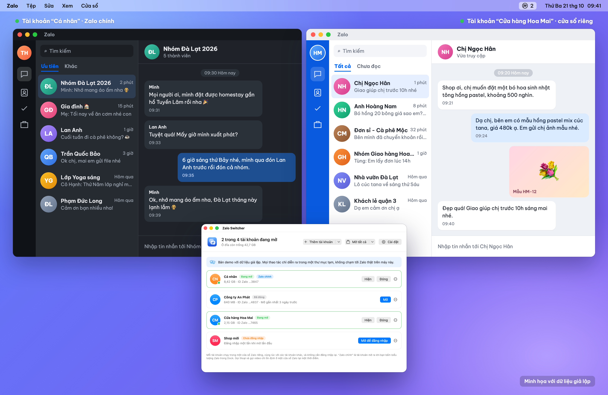
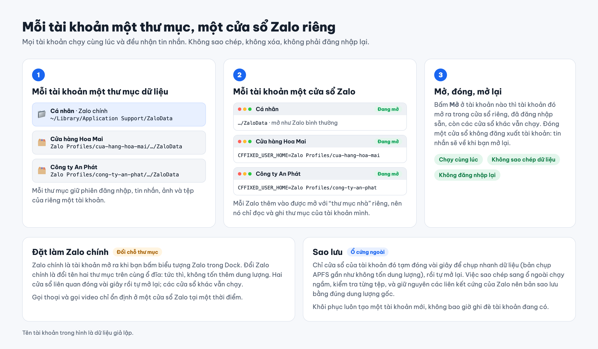
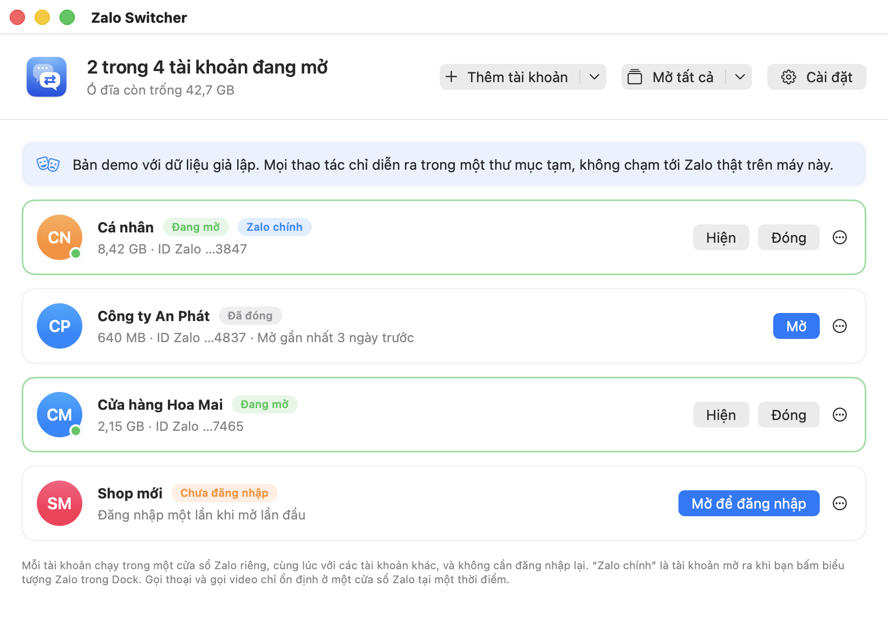
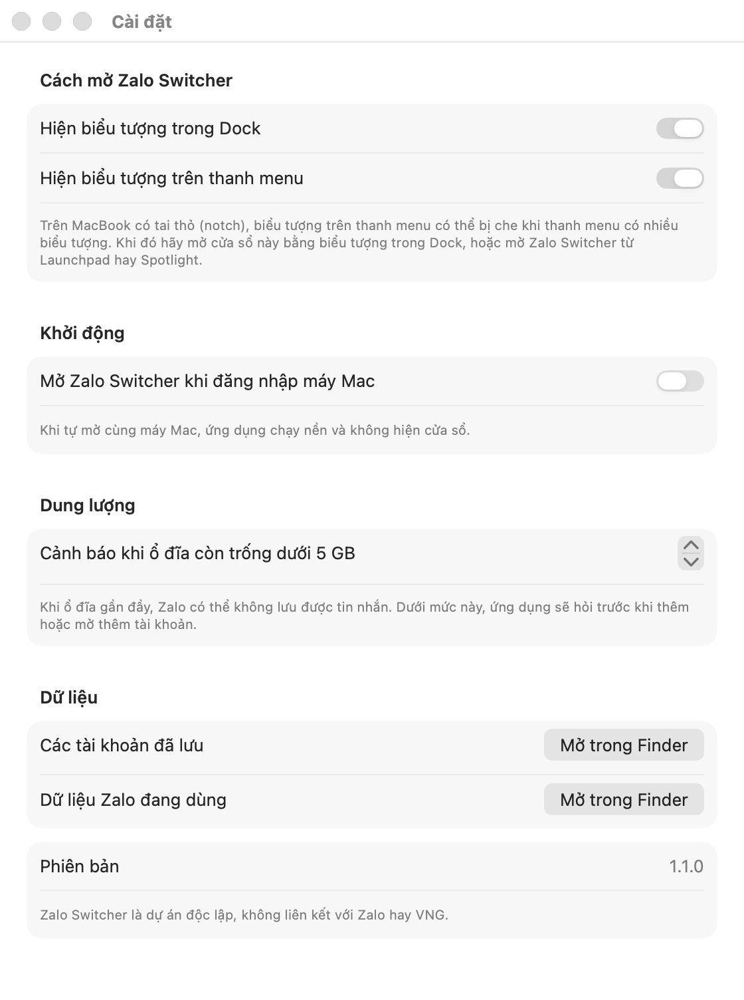
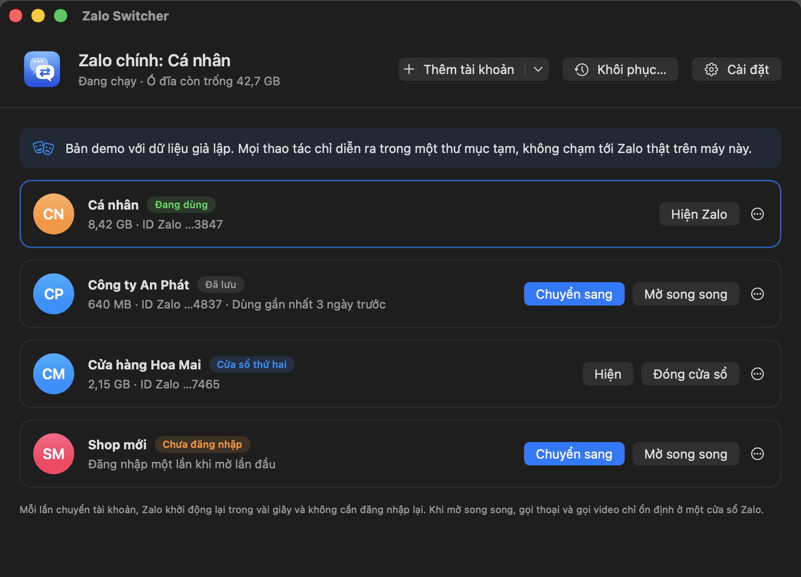
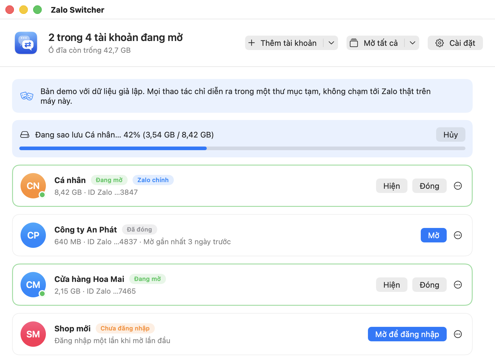
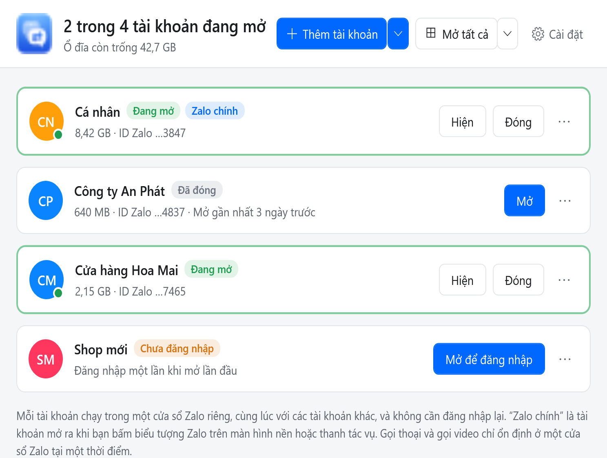

<p align="center"></p>

# Zalo Switcher

Dùng nhiều tài khoản Zalo cùng lúc trên một máy Mac. Mỗi tài khoản mở trong một cửa sổ Zalo riêng, đã đăng nhập sẵn và nhận tin nhắn như bình thường. Bạn không phải đăng xuất, nhập lại mật khẩu hay quét lại mã QR, và không mất tin nhắn, ảnh hay tệp nào.

<p align="center"></p>
<p align="center"><sub>Minh họa với dữ liệu giả lập.</sub></p>

Dành cho **macOS** (macOS 13 trở lên) và **Windows** (Windows 10 trở lên). Phần lớn README này nói về bản macOS; bản Windows có cùng chức năng và cùng quy tắc an toàn, và những chỗ khác nằm trong mục [Windows](#windows).

Có hai cách dùng, chung một mã nguồn:

- **Zalo Switcher.app**: ứng dụng có cửa sổ, biểu tượng trong Dock và biểu tượng trên thanh menu.
- **`zalo-profiles`**: công cụ dòng lệnh trong Terminal.

> [!IMPORTANT]
> **Không liên kết với Zalo.** Zalo Switcher là dự án độc lập, không chính thức. Dự án không do Zalo hay VNG làm ra, bảo trợ hay hỗ trợ, và tác giả không có liên quan gì tới thương hiệu Zalo. “Zalo” là nhãn hiệu của chủ sở hữu, chỉ được nhắc tới ở đây để nói công cụ này dùng với ứng dụng nào. Nếu cần hỗ trợ về Zalo, hãy liên hệ Zalo, không phải dự án này.

> [!WARNING]
> **Bạn tự chịu rủi ro khi sử dụng.** Zalo Switcher mở Zalo trên các thư mục chứa toàn bộ tin nhắn, ảnh và tệp Zalo của bạn, và đổi tên các thư mục đó khi bạn đổi Zalo chính. Ứng dụng được viết cẩn thận (chỉ đổi tên thư mục, không bao giờ xóa dữ liệu Zalo, và dừng lại ngay khi có gì bất thường), nhưng không có bất kỳ bảo hành nào. **Tác giả không chịu trách nhiệm nếu bạn mất dữ liệu, mất quyền truy cập tài khoản hay gặp bất kỳ vấn đề nào khác khi sử dụng.** Hãy sao lưu dữ liệu Zalo trước khi bắt đầu, và giữ bản sao lưu của những gì bạn không thể để mất. Xem [LICENSE](LICENSE).

## Mục lục

- [Giới hạn, và vì sao có các giới hạn đó](#giới-hạn-và-vì-sao-có-các-giới-hạn-đó)
- [Cách hoạt động](#cách-hoạt-động)
- [Cài đặt](#cài-đặt)
- [Sử dụng](#sử-dụng)
- [Bản demo](#bản-demo)
- [Dùng bằng dòng lệnh](#dùng-bằng-dòng-lệnh)
- [Dung lượng ổ đĩa](#dung-lượng-ổ-đĩa)
- [Sao lưu và khôi phục](#sao-lưu-và-khôi-phục)
- [Nhiều cửa sổ Zalo cùng lúc](#nhiều-cửa-sổ-zalo-cùng-lúc)
- [Windows](#windows)
- [Lưu ý thêm](#lưu-ý-thêm)
- [Cấu trúc dự án](#cấu-trúc-dự-án)

## Giới hạn, và vì sao có các giới hạn đó

Có những việc công cụ này không làm được. Phần lớn là do cách Zalo hoạt động chứ không phải do ứng dụng này, và không ứng dụng nào trên máy tính của bạn thay đổi được.

**Một tài khoản không thể đăng nhập cùng lúc trên hai điện thoại, hai máy tính hay hai phiên Zalo Web.** Máy chủ của Zalo chỉ cho mỗi tài khoản một phiên của mỗi loại tại một thời điểm: một điện thoại, một ứng dụng Zalo trên máy tính và một phiên web ([chat.zalo.me](https://chat.zalo.me)). Đăng nhập trên điện thoại thứ hai sẽ đăng xuất điện thoại thứ nhất. Đăng nhập ứng dụng Zalo trên máy tính thứ hai sẽ kết thúc phiên trên máy thứ nhất, và trình duyệt thứ hai cũng vậy. Quy tắc này do máy chủ của Zalo áp dụng, nên Zalo Switcher không gỡ bỏ được, và không ứng dụng nào trên máy tính của bạn gỡ được. Zalo không công bố con số chính thức và các bài viết trên mạng nói khác nhau; điều mô tả ở đây khớp với những gì bạn thấy trên tài khoản của mình.

Cách làm được là dùng cùng lúc các loại phiên khác nhau, ví dụ:

- điện thoại của bạn,
- ứng dụng Zalo trên máy tính A,
- [chat.zalo.me](https://chat.zalo.me) trong trình duyệt trên máy tính B (đăng nhập bằng mã QR từ điện thoại).

Cả ba vẫn đăng nhập cùng lúc. Hãy thử một lần trên tài khoản của bạn: đăng nhập trình duyệt trên máy B trong khi ứng dụng trên máy A đang mở, và kiểm tra máy A vẫn còn đăng nhập.

Zalo Switcher làm một việc khác: giữ **nhiều tài khoản khác nhau** trên **một** máy Mac và mở chúng cùng lúc, mỗi tài khoản một cửa sổ Zalo.

**Ứng dụng không sao chép phiên đăng nhập sang máy tính khác.** Sao chép thư mục dữ liệu Zalo đã đăng nhập sang máy Mac thứ hai để cả hai chạy “cùng một” phiên không vượt qua được quy tắc trên. Máy chủ Zalo sẽ thấy một phiên kết nối từ hai nơi. Nhẹ thì một bản bị đăng xuất; nặng thì tài khoản bị đánh dấu có hoạt động bất thường. Rủi ro đó không đáng với tài khoản chính của bạn, nên dự án này không làm việc đó.

**Chỉ tài khoản đang mở mới nhận tin nhắn và thông báo.** Tài khoản đã đóng vẫn đăng nhập trên máy chủ Zalo, nhưng trên máy Mac không có gì đang nghe tin nhắn cho nó. Tin nhắn sẽ về khi bạn mở lại, giống như khi máy Mac tắt trong khoảng thời gian đó. Muốn mọi tài khoản luôn nhận tin, hãy để chúng cùng mở, hoặc cho Zalo Switcher tự mở mọi tài khoản khi bạn đăng nhập máy Mac (xem [Cài đặt](#cài-đặt-1)).

**Gọi thoại và gọi video chỉ ổn định ở một cửa sổ.** Phần gọi điện của Zalo dùng các tệp socket cố định, nên khi nhiều Zalo cùng chạy, chỉ một cửa sổ gọi được ổn định. Xem [Nhiều cửa sổ Zalo cùng lúc](#nhiều-cửa-sổ-zalo-cùng-lúc).

**Mỗi cửa sổ là một ứng dụng Zalo đầy đủ.** Mỗi tài khoản đang mở dùng thêm bộ nhớ như khi chạy thêm một Zalo, và có biểu tượng Zalo riêng trong Dock.

**Mỗi tài khoản chiếm dung lượng riêng.** Mỗi tài khoản giữ trọn bộ dữ liệu Zalo của riêng nó, thường vài GB trở lên, vì Zalo lưu dữ liệu như vậy.

**Ứng dụng phụ thuộc vào nơi Zalo lưu dữ liệu.** Zalo không có cách chính thức để chạy nhiều tài khoản, nên công cụ này làm việc với thư mục mà Zalo đang dùng hiện nay. Nếu một bản cập nhật của Zalo đổi thư mục đó, công cụ sẽ không tìm thấy nó và không di chuyển gì, cho tới khi được cập nhật.

**Bản tải về chưa được Apple công chứng (notarize).** macOS sẽ hiện cảnh báo bảo mật ở lần mở đầu tiên. Mục [Cảnh báo bảo mật ở lần mở đầu tiên](#cảnh-báo-bảo-mật-ở-lần-mở-đầu-tiên) giải thích lý do và cách mở.

## Cách hoạt động

<p align="center"></p>

Zalo lưu mọi thứ (phiên đăng nhập, cơ sở dữ liệu tin nhắn, ảnh, tệp, cài đặt) trong một thư mục:

```
~/Library/Application Support/ZaloData        ← thư mục Zalo dùng khi được mở theo cách bình thường
```

Zalo bỏ qua tùy chọn `--user-data-dir` quen thuộc và luôn dùng đường dẫn đó, nên Zalo Switcher giữ cho mỗi tài khoản một bản đầy đủ của thư mục này:

```
~/Library/Application Support/ZaloData                  ← tài khoản Zalo chính, ví dụ “Cá nhân”
~/Library/Application Support/Zalo Profiles/
    ca-nhan/profile.json
    cua-hang/profile.json
    cua-hang/Library/Application Support/ZaloData     ← dữ liệu của “Cửa hàng”
```

Mỗi thư mục tài khoản có dạng như một thư mục nhà (home). Khi bạn mở một tài khoản, Zalo Switcher mở thêm một Zalo với biến môi trường `CFFIXED_USER_HOME` trỏ tới thư mục đó. macOS khi đó cho Zalo ấy một thư mục Application Support riêng, nên nó đọc và ghi `ZaloData` của đúng tài khoản đó, cùng lúc với các Zalo khác, và không bao giờ chạm vào dữ liệu của chúng. Mở một tài khoản không sao chép hay di chuyển gì.

**Zalo chính** là tài khoản nằm ở `~/Library/Application Support/ZaloData`: tài khoản mở ra khi bạn bấm biểu tượng Zalo trong Dock hay Launchpad, hoặc khi Zalo tự mở cùng máy Mac. Muốn tài khoản khác làm Zalo chính, chọn **⋯ → Đặt làm Zalo chính…** Ứng dụng khi đó:

1. Yêu cầu cửa sổ Zalo của hai tài khoản đó thoát (như khi bấm ⌘Q) và đợi đến khi chúng cùng các tiến trình phụ đóng hẳn. Ứng dụng không bao giờ buộc một Zalo đang có tài khoản đăng nhập phải thoát. Nếu Zalo không thoát, mọi thứ dừng lại và chưa có gì bị di chuyển.
2. Đổi tên `ZaloData` thành thư mục của tài khoản Zalo chính cũ.
3. Đổi tên thư mục của tài khoản mới thành `ZaloData`.
4. Mở lại cả hai, đã đăng nhập sẵn: tài khoản mới trong Zalo chính, tài khoản cũ trong cửa sổ riêng. Các cửa sổ khác vẫn chạy suốt quá trình.

Mỗi bước chỉ là đổi tên thư mục trên cùng một ổ đĩa: mất chưa tới một giây dù thư mục lớn bao nhiêu, không tốn thêm dung lượng, và không bao giờ sao chép hay xóa gì. Ứng dụng còn từ chối:

- đổi Zalo chính khi tài khoản đang ở Zalo chính chưa được lưu, để dữ liệu của nó không bị mất;
- mở cùng một tài khoản Zalo ở hai cửa sổ (ví dụ một tài khoản và bản khôi phục của nó), vì hai cửa sổ sẽ dùng chung một phiên đăng nhập;
- thay thế bất cứ thứ gì ở nơi đến (nếu bất ngờ có một thư mục chắn đường, ứng dụng dừng lại);
- di chuyển dữ liệu sang ổ đĩa khác (vì như vậy là sao chép).

Xóa một tài khoản sẽ chuyển thư mục của nó vào Thùng rác, nơi bạn vẫn lấy lại được.

Toàn bộ quy tắc, kể cả định dạng tệp, có trong [docs/how-it-works.md](docs/how-it-works.md).

## Cài đặt

Bạn cần macOS 13 trở lên và ứng dụng Zalo cho máy tính. Zalo Switcher chạy trên máy Mac dùng chip Apple và chip Intel.

1. Tải tệp **Zalo-Switcher-…-macOS.zip** từ [bản phát hành mới nhất](https://github.com/ducngfi/zalo-multi-accounts/releases/latest).
2. Mở tệp zip (Safari tự mở giúp bạn) và kéo **Zalo Switcher.app** vào thư mục **Ứng dụng** (Applications).
3. Mở Zalo Switcher. Lần đầu tiên, macOS sẽ hiện cảnh báo bảo mật: xem mục ngay dưới.
4. Cửa sổ Zalo Switcher sẽ mở ra. Hãy [lưu tài khoản đầu tiên](#sử-dụng).

### Cảnh báo bảo mật ở lần mở đầu tiên

macOS cảnh báo với mọi ứng dụng chưa được Apple kiểm tra (công chứng). Muốn công chứng cần tài khoản Apple Developer trả phí, mà dự án miễn phí này không có, nên bạn sẽ thấy cảnh báo một lần. Cảnh báo không có nghĩa là macOS tìm thấy vấn đề trong ứng dụng. Toàn bộ mã nguồn nằm trong kho này; nếu không muốn tin bản tải về, bạn có thể [tự build](#tự-build).

**macOS 15 Sequoia trở lên, kể cả macOS 26 Tahoe:**

1. Mở ứng dụng. macOS báo không thể xác minh “Zalo Switcher” không chứa phần mềm độc hại. Bấm **Xong**, đừng bấm Chuyển vào Thùng rác.
2. Mở **Cài đặt hệ thống → Quyền riêng tư & Bảo mật** và cuộn xuống phần **Bảo mật**. Bên cạnh dòng báo “Zalo Switcher” đã bị chặn, bấm **Vẫn mở**.
3. Bấm **Vẫn mở** lần nữa trong hộp thoại hiện ra, rồi xác nhận bằng mật khẩu hoặc Touch ID.

**macOS 13 Ventura và 14 Sonoma:**

1. Trong Finder, mở **Ứng dụng**, giữ phím Control và bấm (hoặc bấm chuột phải) vào **Zalo Switcher**, chọn **Mở**.
2. Bấm **Mở** trong hộp thoại hiện ra.

**Mọi phiên bản, bằng Terminal:** lệnh này gỡ dấu “tải về từ internet” khiến macOS kiểm tra ứng dụng. Sau đó mở ứng dụng như bình thường.

```bash
xattr -dr com.apple.quarantine "/Applications/Zalo Switcher.app"
```

Bạn chỉ cần làm việc này một lần. macOS có thể hỏi lại khi bạn cài phiên bản mới.

### Công cụ dòng lệnh (không bắt buộc)

Tải tệp **zalo-profiles-…-macOS.zip** từ cùng bản phát hành và mở nó, để tệp `zalo-profiles` nằm trong thư mục Tải về (Downloads). Sau đó, trong Terminal:

```bash
mkdir -p ~/.local/bin
mv ~/Downloads/zalo-profiles ~/.local/bin/
xattr -c ~/.local/bin/zalo-profiles
```

Dòng cuối gỡ dấu tải về, nếu không macOS sẽ chặn lệnh. Nếu Terminal báo `command not found: zalo-profiles`, hãy thêm thư mục đó vào đường dẫn rồi mở cửa sổ Terminal mới:

```bash
echo 'export PATH="$HOME/.local/bin:$PATH"' >> ~/.zshrc
```

Để kiểm tra tệp tải về, chạy `shasum -a 256 -c SHA256SUMS.txt` trong thư mục chứa các tệp zip và tệp `SHA256SUMS.txt` của bản phát hành.

### Tự build

Bạn cần bộ công cụ lập trình của Apple để có `swift`: Xcode, hoặc Command Line Tools (`xcode-select --install`).

```bash
git clone https://github.com/ducngfi/zalo-multi-accounts.git
```

```bash
zalo-multi-accounts/macos/scripts/install.sh
```

Lệnh này build ứng dụng và công cụ dòng lệnh, cài `~/Applications/Zalo Switcher.app` và `~/.local/bin/zalo-profiles`, rồi mở ứng dụng. Ứng dụng tự build trên máy của bạn mở được ngay, không có cảnh báo bảo mật. Muốn build mà không cài, chạy `macos/scripts/build.sh` (kết quả nằm trong `macos/build/`).

## Sử dụng

### Mở cửa sổ Zalo Switcher

Cửa sổ tự mở khi bạn mở ứng dụng. Sau đó, bạn mở lại cửa sổ bằng bất kỳ cách nào sau:

- bấm biểu tượng **Zalo Switcher trong Dock**;
- mở Zalo Switcher từ **Launchpad**, **Spotlight** (⌘ Space, gõ “Zalo Switcher”) hoặc thư mục **Ứng dụng**;
- bấm biểu tượng hai người trên **thanh menu** ở đầu màn hình (bên cạnh là số cửa sổ Zalo đang mở), rồi chọn **Mở cửa sổ Zalo Switcher…**

Trên MacBook có tai thỏ (notch), biểu tượng trên thanh menu có thể bị che khi thanh menu có nhiều biểu tượng. Vì vậy biểu tượng trong Dock được bật sẵn, và bạn luôn mở được cửa sổ bằng Dock, Launchpad hoặc Spotlight. Đóng cửa sổ không thoát ứng dụng; muốn thoát, chọn **Zalo Switcher → Thoát Zalo Switcher** (⌘Q).

### Thêm tài khoản và mở chúng cùng lúc

<p align="center"></p>

1. Lần đầu mở, cửa sổ báo Zalo chính đang giữ một tài khoản chưa được lưu. Bấm **Lưu tài khoản này…** và đặt tên, ví dụ “Cá nhân”. Zalo vẫn chạy bình thường. Nếu máy Mac chưa có Zalo nào đăng nhập, bỏ qua bước này: tài khoản đầu tiên bạn thêm sẽ thành Zalo chính.
2. Bấm **Thêm tài khoản** và đặt tên cho tài khoản tiếp theo, ví dụ “Cửa hàng”. Một cửa sổ Zalo mới mở ở màn hình đăng nhập, còn các tài khoản đang mở vẫn chạy. Đăng nhập tài khoản đó một lần (mã QR hoặc mật khẩu).
3. Từ đó trở đi, mỗi tài khoản có:
   - **Mở**: mở tài khoản trong một cửa sổ Zalo riêng, đã đăng nhập sẵn;
   - **Hiện**: đưa cửa sổ của tài khoản đang mở lên trước;
   - **Đóng**: thoát riêng cửa sổ đó (như ⌘Q trong cửa sổ đó). Tài khoản vẫn đăng nhập, và tin nhắn sẽ về khi bạn mở lại.

   Tài khoản đang mở có nhãn **Đang mở** và chấm xanh. Tài khoản Zalo chính có thêm nhãn **Zalo chính**.
4. **Mở tất cả** mở mọi tài khoản đã đăng nhập, mỗi tài khoản một cửa sổ. Mũi tên bên cạnh có **Đóng mọi cửa sổ Zalo…**, và mũi tên bên cạnh **Thêm tài khoản** có **Khôi phục từ bản sao lưu…**

Mỗi tài khoản hiện dung lượng, ID Zalo (bốn số cuối) và lần mở gần nhất. Nút **⋯** của mỗi tài khoản có **Sao lưu…**, **Đổi tên…**, **Đặt làm Zalo chính…** và **Chuyển vào Thùng rác…** (chỉ khi tài khoản đã đóng và không phải Zalo chính).

Biểu tượng trên thanh menu và menu của biểu tượng trong Dock (bấm chuột phải) liệt kê các tài khoản, có dấu tích ở tài khoản đang mở: bấm một tài khoản để mở nó hoặc đưa nó lên trước. Hai menu này cũng có **Mở tất cả**, **Đóng** và **Thêm tài khoản…**

**Nâng cấp từ bản 1.1 trở về trước:** các tài khoản đã lưu giữ nguyên. Nút **Chuyển sang** được thay bằng **Mở**, và việc đổi tài khoản nằm trong Zalo chính chuyển vào **⋯ → Đặt làm Zalo chính…**

### Cài đặt

<p align="center"></p>

Bấm **Cài đặt** trong cửa sổ (hoặc ⌘,) để:

- bật hoặc tắt biểu tượng trong Dock và biểu tượng trên thanh menu (nếu tắt cả hai, bạn vẫn mở được ứng dụng từ Launchpad, Spotlight hoặc thư mục Ứng dụng);
- cho Zalo Switcher tự mở khi đăng nhập máy Mac (khi đó ứng dụng chạy nền, không hiện cửa sổ), và khi đó mở luôn mọi tài khoản đã đăng nhập, mỗi tài khoản một cửa sổ (bật sẵn);
- chọn mức dung lượng trống mà dưới mức đó ứng dụng sẽ cảnh báo (mặc định 5 GB);
- mở thư mục các tài khoản đã lưu hoặc thư mục dữ liệu của Zalo chính trong Finder.

Ứng dụng có cả giao diện sáng và tối, theo cài đặt của máy Mac:

<p align="center"></p>

## Bản demo

Muốn xem thử hoặc giới thiệu ứng dụng mà không để lộ dữ liệu của mình, hãy mở bản demo:

```bash
open -n "/Applications/Zalo Switcher.app" --args --demo
```

Bản demo dùng bốn tài khoản giả lập (“Cá nhân”, “Cửa hàng Hoa Mai”, “Công ty An Phát”, “Shop mới”) trong một thư mục tạm. Mọi nút đều hoạt động thật trên dữ liệu giả lập đó: mở, đóng, mở tất cả, đặt làm Zalo chính, sao lưu, khôi phục, đổi tên, xóa. Bản demo không bao giờ mở Zalo thật và không chạm tới dữ liệu Zalo của bạn, và cài đặt của nó được lưu riêng. Các ảnh chụp màn hình trong README này được tạo từ bản demo (xem [Ảnh minh họa](#ảnh-minh-họa)).

## Dùng bằng dòng lệnh

```bash
zalo-profiles status                 # mọi tài khoản, tài khoản nào đang mở, dung lượng, dung lượng trống
zalo-profiles save "Cá nhân"         # lưu tài khoản đang có trong Zalo chính
zalo-profiles add "Cửa hàng"         # thêm tài khoản và mở nó ở cửa sổ mới để đăng nhập
zalo-profiles open cua-hang          # mở trong cửa sổ Zalo riêng (theo tên hoặc mã)
zalo-profiles open --all             # mở mọi tài khoản đã đăng nhập
zalo-profiles close cua-hang         # đóng cửa sổ của "cua-hang"
zalo-profiles close --all            # đóng mọi cửa sổ Zalo
zalo-profiles main cua-hang          # đặt làm Zalo chính
zalo-profiles rename cua-hang "Shop"
zalo-profiles remove cua-hang        # chuyển vào Thùng rác
zalo-profiles backup ca-nhan /Volumes/OCung
zalo-profiles restore "/Volumes/OCung/Zalo Backups/ca-nhan 2026-10-20 21.00" "Cá nhân (khôi phục)"
zalo-profiles paths
```

Mã của tài khoản là tên viết không dấu, ví dụ “Cá nhân” → `ca-nhan`; bạn cũng có thể gõ tên đầy đủ trong dấu ngoặc kép. Lệnh `switch` của bản 1.1 vẫn dùng được, nay là tên khác của `main`.

## Dung lượng ổ đĩa

Dung lượng của từng tài khoản và dung lượng trống của máy Mac hiện trong cửa sổ, trong menu và trong `zalo-profiles status`. Khi dung lượng trống dưới 5 GB (hoặc mức bạn chọn trong Cài đặt):

- cửa sổ hiện cảnh báo và biểu tượng trên thanh menu đổi thành hình tam giác cảnh báo;
- thêm tài khoản hoặc mở thêm tài khoản sẽ hỏi trước. Trong dòng lệnh, `add` và `open` từ chối chạy trừ khi bạn thêm `--force`.

Zalo ghi tin nhắn và ảnh ngay khi chúng đến, nên ổ đĩa đầy là nguyên nhân chính khiến dữ liệu Zalo có thể bị hỏng. Bản thân việc mở một tài khoản hay đổi Zalo chính không cần dung lượng trống, vì không sao chép gì.

## Sao lưu và khôi phục

<p align="center"></p>

**⋯ → Sao lưu…** ở một tài khoản (hoặc `zalo-profiles backup <tài khoản> <thư mục>`) sao chép toàn bộ dữ liệu Zalo của tài khoản đó vào thư mục bạn chọn, thường là một ổ cứng ngoài. Bản sao lưu nằm trong `Zalo Backups/<tài khoản> <ngày giờ>/` trên ổ đó:

1. Nếu Zalo đang mở tài khoản đó, cửa sổ Zalo ấy tạm đóng vài giây, để cơ sở dữ liệu được ghi trọn vẹn chứ không dở dang.
2. Ứng dụng chụp nhanh dữ liệu bằng APFS: một bản sao tức thì, dùng chung dung lượng với bản gốc nên gần như không tốn gì.
3. Zalo tự mở lại. Mọi cửa sổ Zalo khác vẫn chạy suốt quá trình.
4. Ứng dụng sao chép bản chụp sang ổ đĩa ở chế độ chạy ngầm và kiểm tra từng tệp có đúng kích thước với bản gốc. Trong lúc đó bạn vẫn dùng, mở và đóng các tài khoản bình thường.

   Zalo lưu nhiều ảnh và video dưới hai tên dùng chung một dữ liệu (liên kết cứng), thường lên tới vài GB. Bản sao lưu chép phần dữ liệu đó một lần và tạo lại tên thứ hai dưới dạng liên kết, nên bản sao lưu có dung lượng bằng đúng bản gốc. Bản chụp APFS làm mất các liên kết này, nên ứng dụng đọc chúng từ bản gốc trong lúc Zalo vẫn đang đóng. Trên ổ đĩa không hỗ trợ liên kết cứng (exFAT, FAT), mỗi tên được chép thành một bản riêng, nên bản sao lưu sẽ lớn hơn.
5. Chỉ khi mọi tệp đều khớp, thư mục mới được đặt tên chính thức và có tệp ghi chép `backup.json`. Bản sao lưu bị lỗi hoặc bị hủy sẽ được xóa chứ không để lại dở dang, và bản chụp luôn được xóa khi xong.

Trước khi bắt đầu, ứng dụng kiểm tra ổ đĩa còn đủ chỗ. Ứng dụng từ chối các thư mục nằm trong dữ liệu của Zalo, và cảnh báo nếu thư mục nằm trên ổ đĩa của chính máy Mac, vì bản sao lưu ở đó không bảo vệ được khi ổ đĩa hỏng.

**Khôi phục…** ở đầu cửa sổ (hoặc `zalo-profiles restore <thư mục sao lưu> <tên>`) khôi phục một bản sao lưu thành một tài khoản **mới**. Không bao giờ thay thế tài khoản đang có. Bản sao được kiểm tra với `backup.json` trước khi tài khoản xuất hiện. Máy Mac cần đủ chỗ cho bản sao lưu cộng thêm 5 GB dự phòng.

Tài khoản khôi phục là cùng một tài khoản Zalo với tài khoản đã được sao lưu. Khi tài khoản gốc vẫn còn, ứng dụng không cho mở cả hai cùng lúc, và `status` sẽ nhắc điều này. Nếu từ lúc sao lưu tài khoản đã đăng nhập ở nơi khác, Zalo có thể yêu cầu đăng nhập lại.

Đã thử ngày 20/10/2026 với một ổ cứng ngoài APFS:

| Tài khoản | Số tệp | Dữ liệu | Zalo tạm đóng | Tổng thời gian |
|---|---|---|---|---|
| Đang mở trong cửa sổ riêng | 508 | 455 MB | dưới 2 giây | 1,9 giây |
| Đang mở trong Zalo chính | 48.056 (13.799 tệp là liên kết cứng) | 13,75 GB | khoảng 15 giây | 75 giây |

- Cả hai lần Zalo đều tự mở lại và vẫn đăng nhập, còn cửa sổ kia không bị gián đoạn.
- Bản sao lưu nhỏ hơn được khôi phục thành một tài khoản thử, trong lúc tài khoản gốc đã đóng, và mở ra vẫn đăng nhập.

## Nhiều cửa sổ Zalo cùng lúc

Tài khoản Zalo chính mở trong Zalo bình thường. Mỗi tài khoản khác mở trong một Zalo riêng với `CFFIXED_USER_HOME` trỏ tới thư mục của tài khoản đó. Nhờ vậy macOS cho nó một thư mục Application Support riêng, nên nó đọc và ghi `ZaloData` của chính tài khoản đó và không bao giờ chạm tới các Zalo khác. Thư mục tài khoản có các liên kết tới Keychain thật của bạn (nơi Zalo giữ khóa mã hóa), cùng Tải về, Màn hình nền, Tài liệu, Ảnh, Phim và Nhạc.

Giới hạn đã biết:

- **Cuộc gọi.** Phần gọi điện của Zalo liên lạc với ứng dụng qua các tệp socket cố định (`/tmp/socketzalosend2021`, `/tmp/socketzalorecv2021`). Mỗi Zalo mở lên sẽ chiếm các tệp này, nên gọi thoại và gọi video chỉ ổn định ở một cửa sổ. Trước một cuộc gọi quan trọng, hãy đóng các tài khoản khác, rồi đóng và mở lại tài khoản cần gọi.
- **Biểu tượng giống nhau.** Mỗi cửa sổ có một biểu tượng Zalo riêng trong Dock, và thanh tiêu đề của mọi cửa sổ đều là “Zalo”. Hãy phân biệt bằng ảnh đại diện và tên tài khoản bên trong cửa sổ, hoặc bấm **Hiện** trong Zalo Switcher để đưa đúng cửa sổ lên trước.
- **Một tài khoản Zalo, một cửa sổ.** Hai bản của cùng một tài khoản (ví dụ tài khoản và bản khôi phục của nó) không mở cùng lúc được.
- **Đóng ở màn hình đăng nhập.** Ở màn hình đăng nhập, Zalo đôi khi đóng cửa sổ nhưng không thoát hẳn khi được yêu cầu thoát. Khi một Zalo như vậy không có tài khoản nào đăng nhập, Zalo Switcher gửi SIGTERM (yêu cầu thoát mà macOS cũng gửi khi tắt máy) để kết thúc nó. Một Zalo đang có tài khoản đăng nhập không bao giờ bị buộc thoát.

Đã thử ngày 20/10/2026 với Zalo 26.8.20 trên macOS 26.1, một tài khoản trong Zalo chính và một tài khoản trong cửa sổ riêng:

- Tài khoản thứ hai mở ra đã đăng nhập sẵn.
- Mỗi Zalo chỉ có dữ liệu của tài khoản mình. Cửa sổ thứ hai mở 163 tệp, tất cả nằm trong thư mục tài khoản của nó, không tệp nào trong `ZaloData` chính.
- Zalo chính vẫn chạy, không phải khởi động lại.
- Zalo thứ hai đúng là chiếm các socket gọi điện như dự đoán. Chưa thử gọi điện.

Ngày 21/10/2026, với bản 1.2.0, một tài khoản được mở rồi đóng bên cạnh Zalo chính hơn mười lần, kể cả bằng **Mở tất cả**. Zalo chính không bị khởi động lại lần nào. Tài khoản thử đã bị đăng xuất từ trước nên mỗi lần đều mở ra ở màn hình đăng nhập, và ở màn hình đó Zalo nhiều lần không thoát hẳn khi được đóng. Với cách xử lý ở trên, những lần đóng sau cùng xong trong 1 đến 5 giây.

## Windows

<p align="center"></p>
<p align="center"><sub>Minh họa với dữ liệu giả lập.</sub></p>

Bản Windows dùng với Zalo cho máy tính bản Windows, và làm được những việc như bản macOS: mở mỗi tài khoản trong một cửa sổ Zalo riêng, đặt Zalo chính, sao lưu và khôi phục, cùng công cụ dòng lệnh `zalo-profiles.exe` với các lệnh như trên.

**Cài đặt.** Tải `ZaloSwitcher-Setup-<phiên bản>.exe` từ trang [Releases](../../releases) rồi mở nó. Ứng dụng được cài cho riêng tài khoản Windows của bạn (không cần quyền quản trị, không cần cài .NET), có trong menu Start, và gỡ được trong **Cài đặt → Ứng dụng**; gỡ cài đặt không xóa Zalo hay các tài khoản đã lưu. Muốn chạy mà không cài, tải `ZaloSwitcher-<phiên bản>-windows-x64.zip`, giải nén rồi mở `ZaloSwitcher.exe`. Các tệp không được ký số, nên ở lần mở đầu tiên Windows SmartScreen có thể hiện “Windows đã bảo vệ máy tính của bạn”: bấm **Thông tin khác** rồi **Vẫn chạy**. Muốn tự build, xem [windows/README.md](windows/README.md).

Những chỗ khác bản macOS:

- Biểu tượng của ứng dụng nằm ở khay hệ thống (góc phải thanh tác vụ, có thể phải bấm mũi tên ^ cạnh đồng hồ), thay cho thanh menu và Dock. Đóng cửa sổ Zalo Switcher chỉ ẩn nó xuống khay; chọn **Thoát Zalo Switcher** trong menu của biểu tượng để thoát.
- “Zalo chính” là tài khoản mở ra khi bạn bấm biểu tượng Zalo trên màn hình nền, thanh tác vụ hoặc menu Start, hoặc khi Zalo tự mở cùng Windows.
- **Sao lưu:** Windows không có bản chụp nhanh như APFS, nên cửa sổ Zalo của tài khoản đang sao lưu đóng trong suốt lúc sao chép (vài phút với tài khoản nhiều dữ liệu), rồi tự mở lại. Các tài khoản khác vẫn chạy.
- **Tin nhắn lưu ở ổ khác:** Zalo cho Windows cho phép chuyển nơi lưu tin nhắn, ảnh và tệp sang ổ khác. Tài khoản như vậy vẫn mở và đổi được bình thường, nhưng Zalo Switcher không sao lưu được nó (tin nhắn không nằm trong thư mục dữ liệu), và không mở cùng lúc hai tài khoản lưu tin nhắn chung một chỗ.
- Nếu thư mục AppData của Windows đã bị chuyển đi chỗ khác (hay gặp ở máy công ty), Windows không cho mở Zalo trong cửa sổ riêng; bạn vẫn đổi qua lại từng tài khoản được bằng **Đặt làm Zalo chính**.
- Dữ liệu của các tài khoản đã cất nằm trong `%LOCALAPPDATA%\Zalo Profiles\<mã>\AppData\Roaming\ZaloData`; Zalo chính vẫn ở `%APPDATA%\ZaloData`.

**Đã thử những gì.** Ngày 21/10/2026, với Zalo 26.10.11 trên Windows 10, bên cạnh một Zalo chính đang đăng nhập: một Zalo thứ hai mở trên thư mục dữ liệu riêng, được ứng dụng nhận ra, đưa lên trước, và thoát sạch trong khoảng một giây khi được đóng; Zalo chính không bị khởi động lại, và thư mục dữ liệu của nó không bị đụng tới. Cùng ngày, một tài khoản thứ hai được thêm và đăng nhập trong cửa sổ riêng, chạy cùng Zalo chính, với dữ liệu nằm trong thư mục tài khoản của nó. **Chưa thử:** đóng rồi mở lại tài khoản đó, dùng lâu dài, đặt Zalo chính và sao lưu với tài khoản thật, và gọi điện. Hãy sao lưu thư mục `%APPDATA%\ZaloData` (khi Zalo đã thoát) trước khi thử.

Cách hoạt động trên Windows có trong mục [Trên Windows](docs/how-it-works.md#trên-windows) của tài liệu kỹ thuật.

## Lưu ý thêm

- Tệp nhận được của mọi tài khoản đều vào thư mục Tải về như bình thường.
- Nếu một bản cập nhật Zalo đổi thư mục dữ liệu, `zalo-profiles status` sẽ không tìm thấy nó nữa. Khi đó không có gì bị di chuyển.
- Muốn thôi dùng Zalo Switcher: đặt tài khoản bạn muốn giữ làm Zalo chính (**⋯ → Đặt làm Zalo chính…**), đóng các tài khoản khác, thoát Zalo Switcher và xóa ứng dụng. Zalo tiếp tục với tài khoản đó. Dữ liệu của các tài khoản khác vẫn nằm trong `~/Library/Application Support/Zalo Profiles/<mã>/Library/Application Support/ZaloData`.

### Ảnh minh họa

Mọi ảnh trong README này chỉ dùng dữ liệu giả lập. Các ảnh cửa sổ Zalo Switcher do chính ứng dụng vẽ ra từ bản demo; ảnh nhiều cửa sổ Zalo và sơ đồ được dựng bằng HTML trong [`docs/screenshots/src`](docs/screenshots/src). Để tạo lại tất cả:

```bash
docs/screenshots/make-screenshots.sh
```

## Cấu trúc dự án

```
macos/              ứng dụng macOS và công cụ dòng lệnh (Swift package)
windows/            ứng dụng Windows và công cụ dòng lệnh (.NET 8, WPF)
docs/               cách hoạt động của tài khoản, giống nhau trên mọi nền tảng
docs/screenshots/   ảnh minh họa của README và cách tạo lại chúng
assets/icon/        biểu tượng ứng dụng: bản gốc SVG và các biểu tượng đã xuất cho macOS và Windows
```

Mỗi nền tảng giữ mã nguồn, script build và kiểm thử trong thư mục riêng. Phần dùng chung là cách hoạt động và định dạng tệp trong [docs/how-it-works.md](docs/how-it-works.md), cùng biểu tượng trong `assets/icon/`. Cách build và kiểm thử có trong [macos/README.md](macos/README.md) và [windows/README.md](windows/README.md).

## Giấy phép

[MIT](LICENSE). Phần mềm được cung cấp “nguyên trạng”, không có bất kỳ bảo hành nào.
